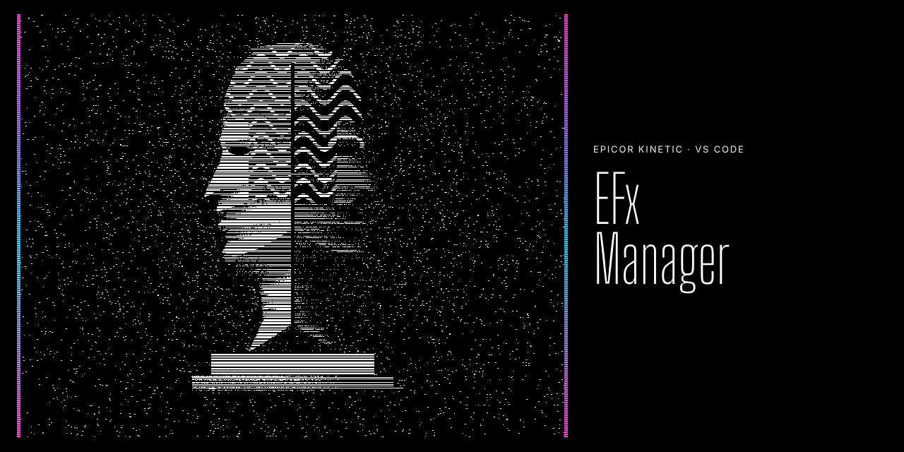
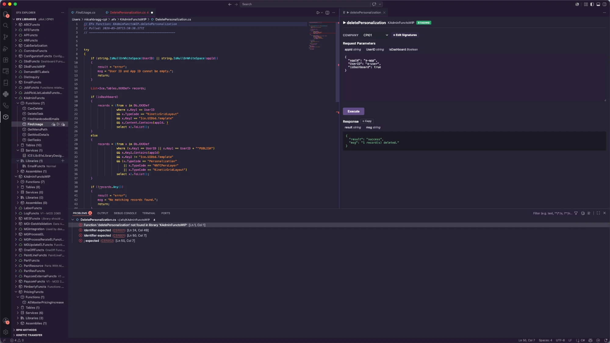

# Epicor EFx Manager



A VS Code extension for working with Epicor Kinetic EFx Function Libraries and BPM Directives directly from your editor — pull, edit, push, execute, and manage signatures without leaving VS Code.



---

## Features

### EFx Function Libraries

- **Browse** all EFx libraries and their functions in the EFx Explorer sidebar
- **Pull** function C# code into a local `.cs` file with one click
- **Push** edited code back to Epicor with live compile diagnostics shown as VS Code squiggles
- **Widget-based functions** open the same widget graph BPM directives use
  - A function whose flow is nothing but one Custom Code widget opens straight as C# — no graph in the way
  - Anything richer opens as a graph; **double-click a Custom Code widget** to edit that widget's C# in a real editor, and saving pushes it back into that exact widget
- **Auto-push on save** — enable per-profile to automatically push every time you save a `.cs` file
- **Execute** functions directly from VS Code with a built-in request/response panel
  - Automatically routes unpromoted (staging) libraries through `/api/v2/efx/staging/...`
  - Copy response to clipboard with one click
  - DataSet/tableset responses render as a parsed table
- **Edit Signatures** — add, remove, or modify request and response parameters and save them directly to Epicor
  - `System.Data.DataSet` and `System.Data.DataTable` available in the type dropdown directly
- **Create** new libraries and functions
  - Add request and response parameters inline during function creation
- **Promote / Demote** libraries to/from production
- **Regenerate / Validate** libraries
- **Manage references** — tables, services, assemblies, and library references
  - Toggle any table reference between **Read-only** and **Updatable** with a right-click
  - `+` button on the Functions group matches the UX of table/service/assembly groups

### BPM Directives

- **Browse** all BPM services, methods, and directives in the BPM Methods sidebar
- **Pull** C# custom code from any directive into a local `.cs` file
- **Push** edited directive code back to Epicor with live compile diagnostics
- **Widget graph** for any directive, with double-click editing of each Custom Code widget

### Environment Comparison

Compare two Epicor environments side by side — click **Compare Libraries** in the
EFx Explorer toolbar, pick a profile and company for each side, and run.

- **Functions** — every library and function across both environments, tagged
  **Match**, **Different**, or **Only in _\<env\>_**
  - Drill into any function for **Code**, **Signature**, and **Metadata** tabs,
    each flagged when it differs
  - Library-level comparison covers references (tables, services, assemblies,
    library refs) and settings such as `DirectDBAccess`,
    `AllowCustomCodeFunctions`, and `Frozen`
  - **Apply** a function's code from one environment to the other — the result is
    read back from the server and verified against the source before it reports
    success
    - A promoted target library is demoted, updated, and re-promoted for you
    - Available for functions that exist in both environments; creating a missing
      function on the target is still a manual step
    - Code and usings only — signatures are pushed separately, and you're warned
      when they still differ
- **BPM** — services, methods, and directives compared on both custom C# code and
  widget structure
  - Widget comparison is semantic: real node, condition, and binding changes show
    up, while designer noise like canvas positions does not
- **Layers** — Kinetic application layers per app, including layers that exist in
  only one environment
- **↗ Diff** on any row opens it in VS Code's native side-by-side diff editor
- BPM and Layers load on demand, so a functions-only comparison stays fast

### Multi-Profile / Multi-Company

- Configure multiple Epicor environment profiles (Dev, Pilot, Prod, etc.)
- Switch between profiles and companies instantly from the toolbar
- Passwords and API keys stored securely in VS Code SecretStorage — never in settings files
- Auto-discovers available companies from the server via the UserFile service
- **Auto-push** setting per profile — toggle in profile setup

---

## Installation

### 1. Install the Extension

Install **Epicor EFx Manager** from the VS Code Marketplace, or download `epicor-efx-manager-<version>.vsix` from the [latest release](https://github.com/mbcpi/epicor-customcode-manager/releases/latest) and install it via **Extensions → ··· → Install from VSIX**, or run:

```
code --install-extension epicor-efx-manager-<version>.vsix
```

### 2. Install the Utilities Library in Epicor

This extension relies on the **Utilities** EFx function library for saving code changes. You must install it in each Epicor environment you want to use the extension with.

The library is one function. Its code and setup steps are in [`EpicorLib/ApplyChangesWithDiagnostics.cs`](EpicorLib/ApplyChangesWithDiagnostics.cs) (also attached to each release). In **Function Library Maintenance**:

1. Create a library named **Utilities** (code functions allowed).
2. Add references — service `ICE:Lib:EfxLibraryDesigner`; assemblies `Ice.Contracts.Lib.EfxLibraryDesigner.dll` and `Newtonsoft.Json.dll`.
3. Add a code function **ApplyChangesWithDiagnostics** with request parameters `inFunctionID` (System.String) and `inDS` (System.Data.DataSet), and response parameters `outMsg` (System.String), `outResult` (System.String), `outSuccess` (System.Boolean).
4. Paste the code from the file (everything below its header), save, and **promote** the library.

**Upgrading from 0.x:** replace the function's code with the 1.0.0 version. It adds batch saves (several functions in one compile — used by the Claude MCP server) and always re-promotes a library it had to demote. The extension still works with the old code; Claude's multi-function pushes then go one at a time.

### 3. Add Utilities to Your Access Scope

Once installed, your Epicor user (or security group) must have execute access to the Utilities library:

1. In Epicor, open **Function Library Access Scope Maintenance**
2. Find or create the access scope assigned to your user or group
3. Add the **Utilities** library to the scope
4. Save and log out/in for the change to take effect

Without this, pushes and saves will fail with an `Access denied (Utilities.ApplyChangesWithDiagnostics)` error.

### 4. Add Your Own Libraries to the Access Scope

Any EFx library you want to pull from, push to, or execute must also be in your access scope:

1. In **Function Library Access Scope Maintenance**, open the relevant scope
2. Add each library you need access to
3. Save — no log out required for library additions

---

## Getting Started

### 1. Configure a Profile

Click the **gear icon** in the EFx Libraries toolbar, or run `EFx: Manage Profiles` from the command palette. You'll be walked through:

- Profile name (e.g. `Dev`, `Prod`)
- Epicor server URL (e.g. `https://your-server/your-app`)
- Username and password
- API key (optional)
- Company selection — the extension will attempt to auto-discover companies you have access to

### 2. Browse Libraries

Once connected, the **EFx Libraries** panel populates with all accessible libraries. Expand a library to see its functions, and expand further to see table/service/assembly/library references.

### 3. Pull and Edit a Function

Click a function node (or the download icon) to pull its C# code into a `.cs` file. The file opens in the editor and live validation runs automatically — compile errors appear as red squiggles.

### 4. Push Changes

Save the file and click the **upload icon** on the function node, or run `EFx: Push Function Code` from the command palette. The extension pushes the code and verifies the server accepted it.

### 5. Execute a Function

Click the **play icon** on a function node to open the Execute panel. Select a company, fill in the request JSON, and click **Execute**. The response appears below.

### 6. Edit Signatures

In the Execute panel, click **⚙ Edit Signatures** to open the signature editor. Switch between the **Request Params** and **Response Params** tabs to add, edit, or remove parameters. Click **💾 Save to Epicor** to persist changes — this updates the actual function definition in Epicor, exactly as if you'd done it in Function Maintenance.

### 7. Manage Table References

Expand any library's **Tables** group to see its table references. Hover a table row to reveal the **✏️ edit icon** — click it to toggle between **Read-only** and **Updatable** without having to remove and re-add the table.

---

## Commands

| Command | Description |
|---|---|
| `EFx: Manage Profiles` | Create, edit, delete, and activate environment profiles |
| `EFx: Switch Profile` | Quickly switch between configured profiles |
| `EFx: Switch Company` | Switch the active company within the current profile |
| `EFx: Refresh Libraries` | Reload the library list from the server |
| `EFx: Pull Function Code` | Pull a function's C# code to a local file |
| `EFx: Push Function Code` | Push edited code back to Epicor |
| `EFx: Open Widget Graph` | Open a widget-based function's flow graph |
| `EFx: Execute Function` | Open the execute panel for a function |
| `EFx: New Library` | Create a new EFx library |
| `EFx: New Function` | Create a new function in a library |
| `EFx: Delete Function` | Delete a function |
| `EFx: Promote to Production` | Promote a library to production |
| `EFx: Demote from Production` | Demote a library from production |
| `EFx: Regenerate / Validate Library` | Regenerate and validate a library |
| `EFx: Set Read-only / Updatable` | Toggle a table reference's access mode (right-click a table in the tree) |
| `BPM: Refresh BPM Methods` | Reload the BPM method tree |
| `BPM: Pull Directive Code` | Pull a BPM directive's C# code |
| `BPM: Push Directive Code` | Push edited BPM directive code back |

---

## Using with Claude (MCP server)

The `mcp/` folder holds an MCP server that lets Claude (Claude Desktop, and Cowork sessions linked to your computer) drive this extension: list, search, pull, compare, push, create/delete functions, references, signatures, execute, profiles, and (if allowed) promote/demote.

**The extension still makes every Epicor call.** The MCP server never sees a password or API key — it writes a request file, the extension runs it, and the result file comes back to Claude as the tool result.

### How a request travels

1. Claude calls a tool. The MCP server writes `<profile folder>/_claude/<id>.json`.
2. If VS Code is running, the extension's file watcher picks it up. If not, the MCP server opens `vscode://micah-bragg.epicor-efx-manager/request?id=<id>`, which starts VS Code and the extension.
3. The extension claims the request (atomic rename, so only one window runs it), writes `<id>.ack.json`, runs it and writes `<id>.result.json`.
4. The MCP server returns the result and deletes the request files.

`~/.efx-manager/bridge.json` (written by the extension) tells the MCP server which profile is active, where its request folder is and what each profile allows. It contains no secrets.

### Guards

- **Per-profile access level** (`claudeAccess`), set only in **EFx: Manage Profiles → Edit Profile** — Claude can never change it, and profiles Claude creates start at `off`:

  | Level | Allows |
  |---|---|
  | `off` (default) | nothing |
  | `read` | list, get, search, pull to disk, list/pull BPM directives, compare profiles |
  | `write` | + push functions/directives, new/delete function, new library, references, signatures, regenerate, execute, switch profile/company, create/edit/delete profiles |
  | `risky` | + promote/demote libraries |

- Every request names a profile and must match the **active** profile. Claude switches only with `switch_profile`, and only to a profile whose access isn't `off`. `compare` needs at least `read` on both profiles.
- Request ids must match `^[A-Za-z0-9-]{8,64}$`. A link alone does nothing: the request file must exist in the active profile's `_claude` folder (a web page can open the link but can't write that file). Requests older than 10 minutes are refused.
- **Promoted libraries:** a change to one comes back as `needsDemote` instead of running, so Claude asks you first. If you say yes, Claude retries with `allowDemote: true` (needs `risky`): the library is demoted, changed, and **always** re-promoted afterwards — even if the change failed. A failed re-promote is reported loudly. Callers of the library fail for the few seconds it's demoted.
- **Locked (frozen, not promoted) libraries** are refused, and so is any file **open in VS Code with unsaved edits** that differ from disk (whitespace and the header don't count).
- Before a push, delete or signature change, the server version is backed up to `<profile folder>/_backup/<timestamp>/`.
- Passwords and API keys are typed by you into a VS Code input box (`create_profile`, `set_profile_secret`) and go straight to SecretStorage.

### Pushing several functions

Several functions in one library are saved in **one** `Utilities.ApplyChangesWithDiagnostics` call (one compile, all or nothing), so a change that spans functions can't land half-applied. This needs the updated `Utilities` library (batch mode: empty `inFunctionID`). With the old one the extension pushes them one at a time and says so. A single function and widget-flow functions always go through the normal push.

### Setup

1. **Allow a profile:** EFx: Manage Profiles → Edit Profile → last step, *Claude access*.
2. **Install the server in Claude Desktop:** download `epicor-efx-manager-<version>.mcpb` from the [latest release](https://github.com/mbcpi/epicor-customcode-manager/releases/latest) and double-click it (or drag it into Claude Desktop → Settings → Extensions). Node ships with Claude Desktop — nothing else to install. Cowork sessions linked to that computer get the tools too.
3. **Or run it from source** (for development): `cd mcp && npm install`, then add it to `claude_desktop_config.json` and restart Claude Desktop:
   ```json
   {
     "mcpServers": {
       "efx-manager": {
         "command": "node",
         "args": ["C:\\path\\to\\epicor-customcode-manager\\mcp\\server.js"]
       }
     }
   }
   ```
   Optional env: `EFX_BRIDGE_FILE` (non-default bridge location), `EFX_URI_SCHEME` (fallback scheme if `bridge.json` doesn't have one; the extension writes the right one for VS Code, Insiders or Cursor).
4. The extension starts with VS Code, so the bridge is up whenever VS Code is open. The first time the MCP server has to launch VS Code, VS Code asks **"Allow 'Epicor EFx Manager' extension to open this URI?"** — allow it.

### Troubleshooting

- *"VS Code didn't pick up the request"* — VS Code isn't running with the extension, the active profile differs, or the URI prompt is waiting.
- *"Claude access … is off"* — enable it for that profile in the profile editor.
- *"No result after Ns"* — the op is still running or waiting on a prompt in VS Code; check VS Code before retrying.

---

## Requirements

- Epicor Kinetic (tested on 2023+)
- REST API access to your Epicor server
- Your Epicor user must have access to `Ice.LIB.EfxLibraryDesignerSvc`
- To use the push/save path via the `Utilities` wrapper library, your user needs EFx execute access to `Utilities.ApplyChangesWithDiagnostics` — if not, the extension falls back to the direct designer service endpoint automatically
- The Utilities wrapper library **must remain published**

---

## Extension Settings

Settings are managed through profiles rather than VS Code settings directly. The following settings are written automatically and should not be edited by hand:

| Setting | Description |
|---|---|
| `efx.profiles` | Array of configured profiles (no secrets — those are in SecretStorage) |
| `efx.activeProfile` | Name of the currently active profile |
| `efx.activeCompany` | Currently selected company |

Each profile also carries `claudeAccess` (`off` / `read` / `write` / `risky`) — see *Using with Claude*.

---

## How Code is Stored Locally

Pulled function code is saved to a `.efx/` folder — either in your workspace root (if a folder is open) or in your home directory. Files are organized as `.efx/{LibraryID}/{FunctionID}.cs`. These files are for editing only; the extension manages pushing them back.

BPM directive code follows the same pattern under `.efx/bpm/{BpMethodCode}/{DirectiveName}.cs`.

---

## Changelog

### 1.0.0
- **Claude MCP server** (`mcp/`, shipped as a one-click `.mcpb` for Claude Desktop): list, search, pull, compare, push functions and BPM directives, create/delete functions, references, signatures, execute, profiles, promote/demote — all through the extension, gated per profile by *Claude access* (off / read / write / risky). See *Using with Claude*.
- **Batch push:** several functions in one library save in one compile (needs the 1.0.0 `ApplyChangesWithDiagnostics` code)
- `Utilities` now ships as the function's source (`EpicorLib/ApplyChangesWithDiagnostics.cs`) instead of a `.efxb` export
- **Promoted libraries:** Claude asks before demoting; demote → change → re-promote happens in one step and always re-promotes
- **BPM:** data directives and updatable-BAQ directives now listed, pulled and pushed (tree groups: Method / Data / UBAQ); compare covers UBAQ directives
- BPM push verifies the saved code and reports errors instead of failing silently
- Pull/push no longer adds a blank line to the top of the function on every round trip; compare ignores whitespace-only differences
- New Library escapes the description properly
- MIT license

### 0.8.0
- **Widget-based functions supported** — the widget XAML parser that powered BPM directives now backs Epicor Functions too, so Kind 0 / Kind 1 functions are no longer hidden from the tree
- A function that is only a Custom Code widget opens straight as C#; multi-widget functions open as a graph
- **Double-click a Custom Code widget** (function or BPM) to edit its C# in a real editor — saving pushes it back into that widget
- Find in Functions indexes widget custom code, and Compare Libraries renders widget functions as a readable flow instead of raw XAML

### 0.6.0
- **Set Read-only / Updatable** — right-click any table reference in the tree to toggle its access mode without removing and re-adding it
- **Source restructure** — all source moved into `src/` with esbuild bundling; cleaner build and easier to contribute to
- **BPM overhaul** — more reliable widget editing and parameter handling
- **`repository` field** added to manifest — fixes vsce warning and makes the auto-updater's GitHub URL canonical

### 0.5.0
- **Auto-updater** — the extension checks GitHub releases on startup and prompts to update when a new version is available; install with one click, no manual VSIX download required
- **BPM Widget panel** — open and edit BPM widget definitions directly from the directive tree
- **Improved diagnostics** — compile errors from push/save surface more reliably across all Epicor versions

### 0.4.0
- **Staging execute** — unpromoted libraries automatically execute via `/api/v2/efx/staging/...` instead of the production endpoint
- **`+` button on Functions group** — add a new function directly from the Functions group header, consistent with table/service/assembly groups
- **Auto-push on save** — new profile setting; when enabled, saving a `.cs` file immediately pushes it to Epicor without a confirmation dialog
- **Params on function creation** — optionally add request and response parameters inline during `New Function`
- **Copy response button** — one-click copy of the raw response JSON in the Execute panel
- **DataSet response parser** — if the response is a tableset/DataSet shape, a rendered table view is shown alongside the raw JSON
- **`System.Data.DataSet` / `System.Data.DataTable` in type dropdown** — no longer requires the "Custom…" workaround

### 0.3.0
- **Signature editor** — add, edit, and remove request/response parameters directly from the Execute panel and save them to Epicor
- **Multi-company execute** — select which company to execute a function against from the Execute panel
- **Multi-profile support** — manage multiple Epicor environment profiles with secure credential storage
- **Switch Profile / Switch Company** toolbar commands
- **Auto-discover companies** from the server during profile setup
- **BPM Directives** — browse, pull, and push BPM custom code with live diagnostics
- **Raw string tableset handling** throughout — prevents int64 SysRevID corruption that caused optimistic locking errors
- **Library references** — add table, service, assembly, and library references from the tree view

### 0.2.3
- Company dropdown in Execute panel
- Live EFx validation on save with diagnostic squiggles
- New library and new function creation
- Promote / demote / regenerate library commands

### 0.2.0
- Initial release: pull, push, execute EFx functions
- Tree view for libraries and functions
- Basic connection configuration

---

## Known Limitations

- Widget graphs are read/edit only — widgets can be re-configured and their C# rewritten, but widgets cannot be added, removed, or re-wired from here
- **Compare Libraries** can diff a widget-based function but cannot apply one across environments (apply writes through the Code/Usings path, which cannot carry a widget flow)
- BPM directives without custom C# code (widget-only) are shown but cannot be pulled as a `.cs` file — edit them from the widget graph
